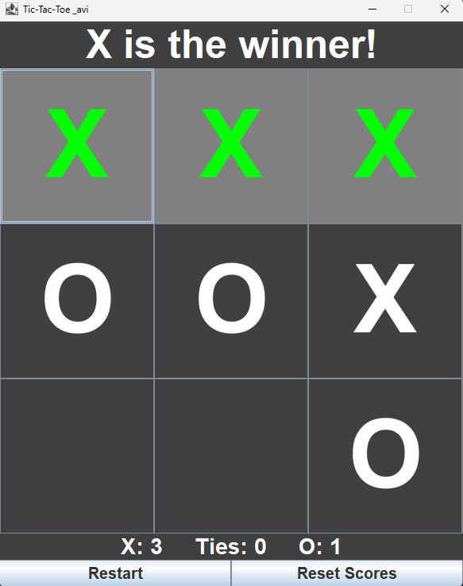

<div align="CENTER">

# ❌ Tic-Tac-Toe ⭕

A two-player Tic-Tac-Toe game built with **Java Swing and AWT**, featuring a scoreboard, win highlighting, and restart functionality.
</div>
<p align="center">
  
  
  
  
</p>

---

## 📑 Table of Contents

- [✨ Features](#-features)
- [🖼️ Preview](#️-preview)
- [🚀 Getting Started](#-getting-started)
- [🎯 How to Play](#-how-to-play)
- [📂 Project Structure](#-project-structure)
- [⚙️ How It Works](#️-how-it-works)
- [🗺️ Roadmap](#️-roadmap)
- [🤝 Contributing](#-contributing)
- [👤 Author](#-author)

---

## ✨ Features

| Feature | Description |
|:---|:---|
| 🎮 **Two-Player Mode** | X and O take turns on the same computer. |
| 🏆 **Score Tracking** | Separate scores for X and O, plus a tie counter. |
| 🔄 **Restart Button** | Clears the board for a new round while keeping the scores. |
| 🧹 **Reset Scores** | Resets all scores to zero and starts a fresh round. |
| 🟢 **Win Highlighting** | Highlights the three winning tiles in green. |
| 🟠 **Tie Detection** | Highlights all tiles in orange when the game ends in a tie. |
| 🖥️ **Simple Swing UI** | Fixed-size 600 × 750 window, centered on the screen. |

---

## 🖼️ Preview

```text
┌─────────────────────────────┐
│         Tic-Tac-Toe         │
│       (Game Status)          │
├───────────┬─────────┬───────┤
│     X     │    O    │   X   │
├───────────┼─────────┼───────┤
│     O     │    X    │       │
├───────────┼─────────┼───────┤
│           │         │   O   │
├───────────┴─────────┴───────┤
│   X: 2      Ties: 1     O: 3│
├─────────────────────────────┤
│    Restart    │ Reset Scores│
└─────────────────────────────┘
```

> 💡 **Game screenshot:** Gameplay screenshot showing the score and winning moment.

```markdown
   X has won 3 times
   O has 1 time
   No tie count till now
```


---

## 🚀 Getting Started

### Prerequisites

- **JDK 11 or newer** (JDK 17+ recommended).
- A Java-compatible IDE (optional).

Check your Java installation:

```bash
java -version
javac -version
```

### Clone and Run

**1. Clone the repository**

```bash
git clone https://github.com/royavi21/TicTacToe.git
```

**2. Navigate to the project directory**

```bash
cd TicTacToe
```

**3. Compile the source files**

```bash
javac App.java TicTacToe.java
```

**4. Run the game**

```bash
java App
```

### 🧩 Running from an IDE

You can also run the project using:

- Visual Studio Code (with Extension Pack for Java)
- IntelliJ IDEA
- NetBeans

Simply open the project folder, open `App.java`, and click **Run** above the `main()` method.

### 🛠️ Troubleshooting

| Problem | Solution |
|:---|:---|
| `javac` is not recognized | Install the JDK and configure the system PATH. |
| Game window doesn't appear | Make sure you're running the application in a graphical desktop environment. |
| `Could not find or load main class App` | Run the command from the directory containing the compiled `.class` files. |

---

## 🎯 How to Play

1. **X always goes first** at the beginning of each round.
2. Click any empty tile to place your mark.
3. Get **three marks in a row** (horizontally, vertically, or diagonally) to win.
4. The winning player earns one point.
5. If all nine tiles are filled without a winner, the round ends in a **tie**.
6. Click **Restart** to start another round without losing the scores.
7. Click **Reset Scores** to clear all scores and start a fresh match.

### 🎮 Controls

| Control | Action |
|:---|:---|
| Any Empty Tile | Place the current player's mark. |
| **Restart** | Clear the board and start a new round. |
| **Reset Scores** | Reset all scores to zero and clear the board. |

---

## 📂 Project Structure

```text
Tic-Tac-Toe/
│
├── App.java          # Application entry point
├── TicTacToe.java    # Game interface, logic and scoring
│
└── README.md         # Project documentation
```

---

## ⚙️ How It Works

The game is developed using **Java Swing and AWT**. Swing handles the graphical user interface, while Java event listeners handle player interactions and game logic.

### 🧠 Game State Management

The following variables are used to manage the game:

| Variable | Purpose |
|:---|:---|
| `board[3][3]` | A 3 × 3 grid containing the game buttons. |
| `currentPlayer` | Stores the current player's mark (`X` or `O`). |
| `turns` | Counts the number of moves made in the current round. |
| `gameOver` | Prevents further moves after a win or tie. |
| `scoreX` | Stores the total wins of player X. |
| `scoreO` | Stores the total wins of player O. |
| `ties` | Counts the number of tied rounds. |

### 🔍 Win Detection

The `checkWinner()` method runs after every move and checks all possible winning combinations:

1. All three rows.
2. All three columns.
3. The main diagonal.
4. The anti-diagonal.
5. A tie, when all nine tiles are occupied and no player has won.

When a winning combination is detected, `declareWinner()` ends the round, updates the scoreboard, and highlights the winning tiles.

### 🔄 Restart Functionality

The `restartGame()` method clears the board and prepares the game for another round.

**Main operations:**

- Clears the text from every button.
- Restores the default tile colors.
- Sets the current player back to X.
- Resets the move counter.
- Sets `gameOver` to `false`.
- Updates the game status label.

**Example implementation:**

```java
void restartGame() {
    for (int r = 0; r < 3; r++) {
        for (int c = 0; c < 3; c++) {
            board[r][c].setText("");
            board[r][c].setBackground(Color.darkGray);
            board[r][c].setForeground(Color.white);
        }
    }

    currentPlayer = playerX;
    gameOver = false;
    turns = 0;

    textLabel.setText("Tic-Tac-Toe");
}
```

**Important:** Restarting a round does not modify the scoreboard. The scores remain unchanged until the user selects **Reset Scores**.

---

## 🗺️ Roadmap

### ✅ Completed

- [x] Two-player gameplay.
- [x] Win detection.
- [x] Tie detection.
- [x] Winning tile highlighting.
- [x] Score tracking for both players.
- [x] Restart functionality.
- [x] Reset scores functionality.

### 🔮 Future Improvements

- [ ] Single-player mode with a computer opponent.
- [ ] Custom player names.
- [ ] Alternate starting player between rounds.
- [ ] Sound effects.
- [ ] Light and dark themes.

---

## 🤝 Contributing

Contributions, suggestions, and improvements are welcome!

If you'd like to contribute:

1. Fork this repository.
2. Create a new branch:

   ```bash
   git checkout -b feature/my-feature
   ```

3. Commit your changes:

   ```bash
   git commit -m "Add my feature"
   ```

4. Push your branch:

   ```bash
   git push origin feature/my-feature
   ```

5. Open a Pull Request.

---

## 👤 Author

**Avijit Roy**

If you enjoyed this project, consider giving the repository a ⭐ on GitHub!

---

<p align="center">
  Made with ☕ and Java
</p>